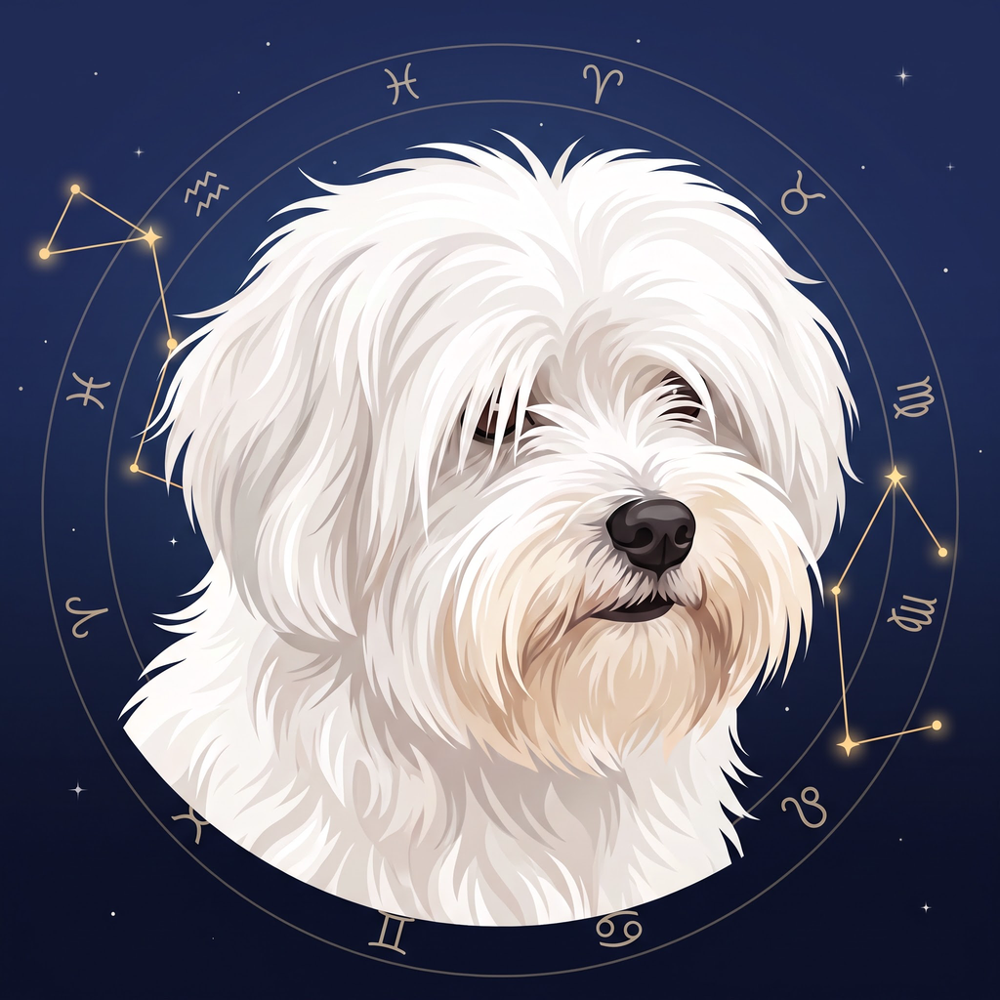

# Donnie Horoscope

An astrology app for Android: a new life for **ZodiacSigns V1.66**, an MS-DOS astrology program from 1992.

The calculation engine was rebuilt from the original program, so planets, house cusps (Placidus and Koch),
aspects and sensitive points come out exactly as in 1992. Around it is a modern, finger-friendly interface,
and the original DOS screens are kept as a *Classic* look in its honour. It is named after Donnie, a much-loved dog.

## Download

**Web page: [donniehoroscope.pages.dev](https://donniehoroscope.pages.dev/)** ·
**Web app: [donniehoroscope.pages.dev/app](https://donniehoroscope.pages.dev/app/)**

| | |
|---|---|
| 🌐 **Web app** | [Open it in your browser](https://donniehoroscope.pages.dev/app/), on a phone or a computer, nothing to install. Same calculations as the app; your charts stay in your browser and can be opened from and saved to .HOR files and chart packs. |
| 📱 **The app** | [DonnieHoroscope-latest.apk](https://github.com/markoboskoauroville/donnie-horoscope-releases/raw/main/downloads/DonnieHoroscope-latest.apk) (version 23): download it and open it on your Android phone (allow installing from this source when asked). Installing over an older version keeps your charts. |
| 📖 **User manual (PDF)** | [donnie-horoscope-manual.pdf](https://github.com/markoboskoauroville/donnie-horoscope-releases/raw/main/donnie-horoscope-manual.pdf): the illustrated guide to every screen. |
| 🗂️ **Silvana's Horoscopes Pack** | [Silvanas-Horoscopes-Pack.zip](https://github.com/markoboskoauroville/donnie-horoscope-releases/raw/main/packs/Silvanas-Horoscopes-Pack.zip): 49 charts. In the app open **Charts → Open chart pack (.zip)…** and pick the downloaded file (or open the .zip with Donnie Horoscope from your file manager). |

Inside the app, *More → Updates and manual → Open download page* brings you to this page.

## What it does

* **Zoom into the chart**: double-tap to zoom in to 200%, drag to move around, double-tap again for the whole chart.
* **Birth charts** with a round chart wheel, planets, houses and aspects (with orbs), retrograde planets, declinations.
* **Birth data form** that the keyboard never covers, with calendar and clock pickers and a live chart preview.
* **World map** (works offline): search about 8,400 places or tap the map; longitude, latitude, time zone and
  daylight saving time are filled in as they were on the birth date.
* **Overview** with sidereal time, planetary weights (elements and modes), the six sensitive points and the Chaldean Lords.
* **PDF export**: one A4 page with the wheel and all tables, to share or print.
* **Charts saved as .HOR files**, the 1992 program's own format, so old files can be imported.
* **Three looks**: Night, Day and Classic DOS (Classic in the Android app).
* **Web app**: the same app in the browser, with the engine compiled from the app's own code.

## Privacy

No account, no internet needed, nothing is sent anywhere. In the Android app your charts are stored only on your phone;
in the web app only in your browser.

## Credits

Calculations: ZodiacSigns V1.66 (12/03/92). Map data: [Natural Earth](https://www.naturalearthdata.com) (public domain).
Astrological symbols: Noto Sans Symbols (SIL Open Font License).
